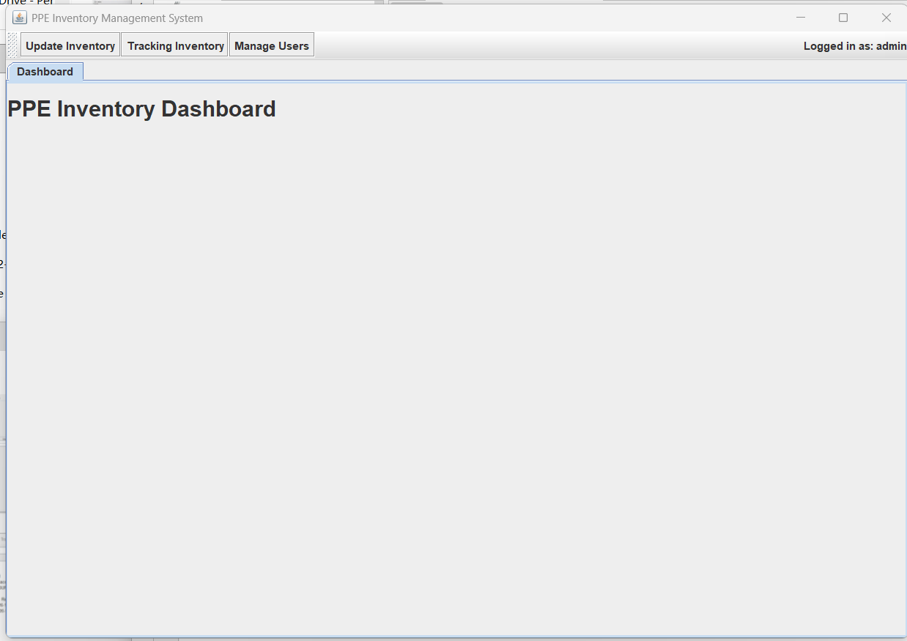
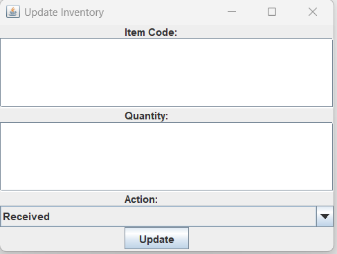
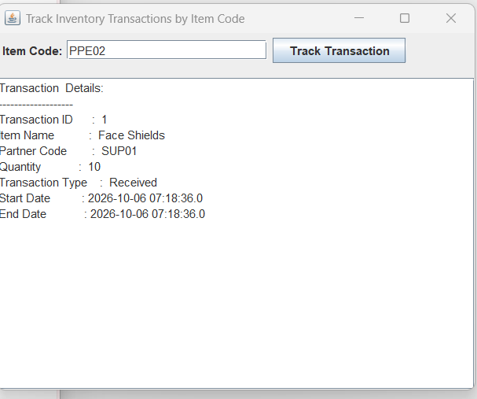
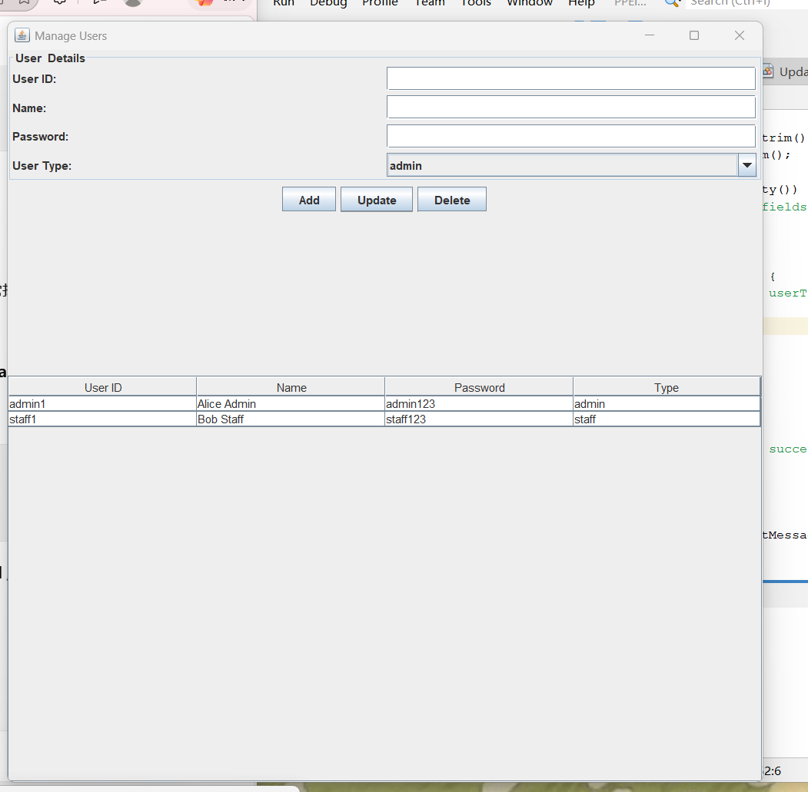

# PPE Inventory Management System

A Java Swing and MySQL-based desktop application for managing Personal Protective Equipment (PPE) inventory. The system supports role-based access, inventory updates, transaction tracking, and user management.

This project was developed as an academic group project for the Object-Oriented Programming module.

## Features

- User login and authentication
- Role-based access for administrators and staff
- PPE inventory receiving and distribution
- Automatic inventory quantity updates
- Inventory transaction tracking by item code
- User management (Add, Update, Delete)
- Supplier, hospital, and PPE item data management
- MySQL database integration using JDBC

## Technologies Used

- Java
- Java Swing
- MySQL
- JDBC
- MySQL Connector/J
- Apache NetBeans
- Ant

## Screenshots

### Admin Dashboard



### Update Inventory



### Transaction Tracking



### User Management



## Project Structure

```text
PPE-Inventory-Management-System/
├── src/
│   ├── DatabaseConnection.java
│   ├── DatabaseConnector.java
│   ├── LoginFrame.java
│   ├── LoginSystem.java
│   ├── MainApp.java
│   ├── MainFrame.java
│   ├── ManageUsersFrame.java
│   ├── PPEInventorySystem.java
│   ├── SetupManager.java
│   ├── TrackInventoryFrame.java
│   ├── UpdateInventoryFrame.java
│   ├── UserManager.java
│   └── MainMenu.java
├── database/
│   └── newSQL.sql
├── screenshots/
└── README.md
```

## Database Setup

1. Install MySQL Server.
2. Open MySQL Workbench.
3. Run `database/newSQL.sql`.
4. The script creates the `ppe_inventory` database and the required tables.
5. Configure the MySQL username and password in the database connection classes before running the application.

Example:

```java
private static final String DB_USER = "root";
private static final String DB_PASSWORD = "your_password";
```

Do not commit real database credentials to a public repository.

## Demo Accounts

| Role | User ID | Password |
|------|---------|----------|
| Admin | admin1 | admin123 |
| Staff | staff1 | staff123 |

These accounts contain sample credentials for local demonstration purposes only.

## My Contribution

This was a group academic project. My main contributions included:

- Database creation and initialization
- Database and application integration testing
- Functional testing and debugging
- System flow analysis
- Designing the activity/flow diagrams for the system modules
- Project documentation

The system-flow documentation covered the main menu, user management, setup management, login process, inventory updating, inventory tracking, and related application components.

## Academic Context

Developed for an Object-Oriented Programming course as a practical application of:

- Object-oriented programming concepts
- Java GUI development
- Database connectivity
- CRUD operations
- Role-based system functionality
- System analysis and design

## Notes

This repository is intended as an academic portfolio project. Database credentials in the source code are placeholders and must be configured locally before running the application.
